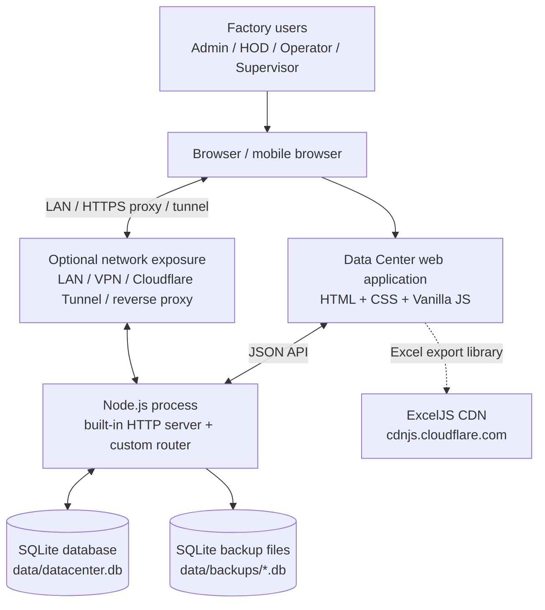
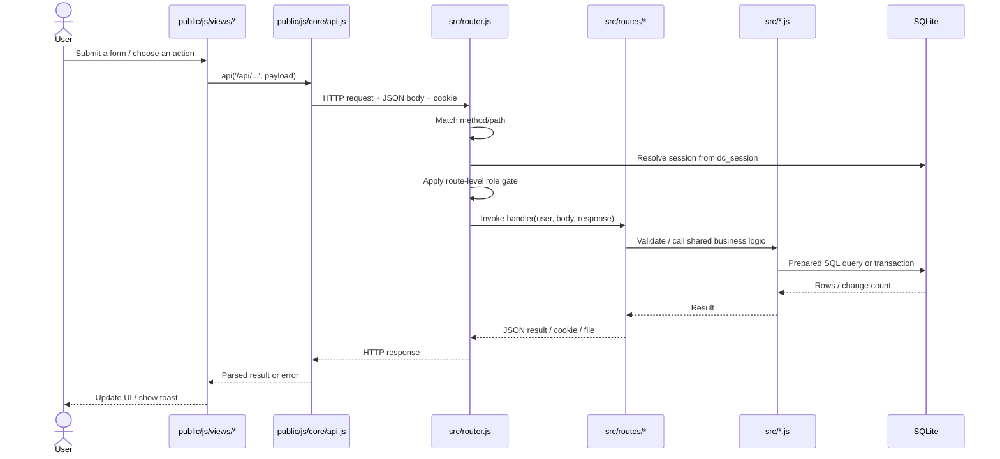

# System Architecture

## Context diagram

## Three application layers

| Layer | Location | Responsibility |
|---|---|---|
| Presentation | `public/` | Login, navigation, screens, reports, forms, styling and PWA assets |
| Application/server | `src/` | HTTP routing, authentication, permissions, validation, business rules and backup orchestration |
| Persistence | `data/datacenter.db` | Users, presses, targets, production entries, departments, workplaces, machines, sessions and audit events |

## Request lifecycle

## Architectural characteristics
- Single Node.js process; deployment guide explicitly says to run one copy against a database file.
- The router is custom rather than Express or another framework.
- Route modules register themselves by calling `route(method, path, role, handler)`.
- The browser receives press configuration through a generated `/config.js` endpoint. The press list is maintained in `src/config.js`.
- Frontend screens are functions stored on the global `V` registry and return HTML strings.
- The database layer exposes small synchronous helpers: `q` (all rows), `q1` (one row), `ex` (write/run), and `cols` (table column names).
- SQLite uses WAL mode and foreign-key enforcement is enabled by migration SQL.

## Important external dependency
`public/index.html` loads ExcelJS 4.4.0 from cdnjs. The npm package declares zero dependencies, but Excel export therefore depends on browser access to that CDN. Printable HTML export has a fallback path if ExcelJS is unavailable.
