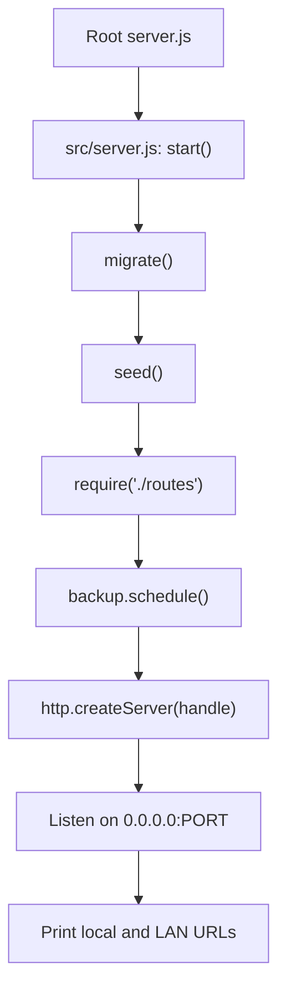

# Runtime and Startup

## Runtime requirements
- Node.js version `22.13` or newer (`package.json` engine: `>=22.13`).
- No npm packages are declared.
- `node:sqlite` is imported from Node's built-in modules.

## Commands
| Command | Effect |
|---|---|
| `node server.js` | Starts the server |
| `npm start` | Runs `node server.js` |
| `npm run dev` | Runs `node --watch server.js` |
| `start.bat` | Windows convenience launcher |
| `start-all.bat` | Windows launcher that also starts the configured tunnel workflow; inspect script before relying on it |

## Startup sequence

### What each startup stage does
1. `src/config.js` resolves `PORT`, `DATA_DIR`, backup folder and retention.
2. `src/db.js` creates the data directory if missing and opens `datacenter.db`.
3. `migrate()` enables WAL and foreign keys, creates tables, and applies additive/compatibility upgrades.
4. `seed()` inserts configured presses and initial accounts if there are no users; it also ensures the super-admin flag and initial Housing department/workplaces.
5. Requiring `src/routes/index.js` loads route modules and populates the router's route registry.
6. `backup.schedule()` creates an automatic backup if today's one is absent and schedules checks every six hours.
7. The HTTP server listens on all network interfaces (`0.0.0.0`) at the configured port.

## Configuration
| Setting | Default | Meaning |
|---|---:|---|
| `PORT` | `3000` | HTTP listen port |
| `DATA_DIR` | `<project>/data` | Database and backup root |
| `BACKUP_KEEP` | `14` | Number of automatic backups retained |

`src/config.js` also defines:
- `F`: press entry numeric fields.
- `HF`: the eight shift-hour categories.
- `PRESSES`: press code, location, size and default daily target.

## Configuration propagation
The server creates `/config.js` dynamically from `PRESSES`. The frontend loads this generated script before its own core scripts. This avoids maintaining the press list in two separate source files.

## Operational note
The database is opened synchronously by `src/db.js` when imported. This is a small single-process architecture. Do not assume it is safe for multiple server instances sharing the same SQLite file.
