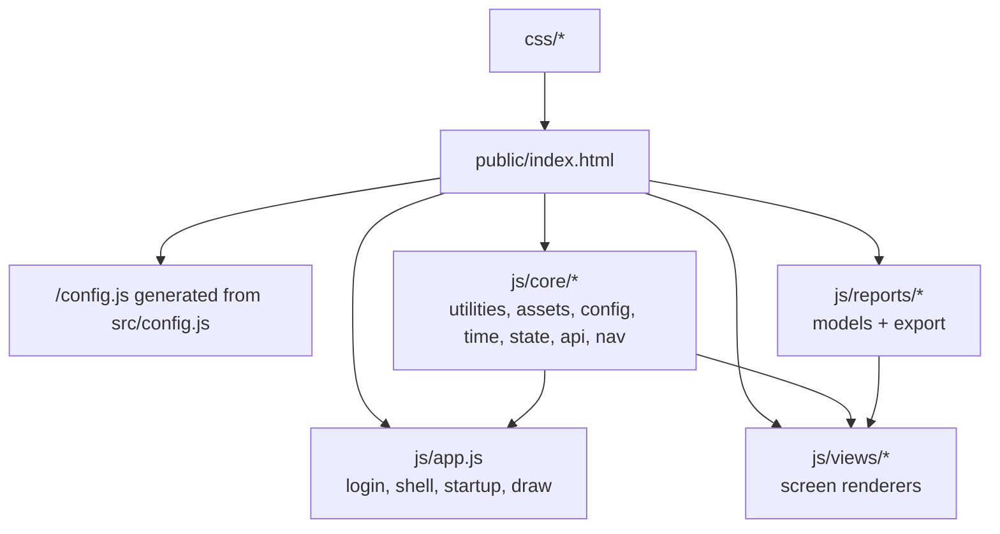

# Frontend Architecture

## Entry point and script dependency order
`public/index.html` provides the document shell and loads scripts in this order:
1. ExcelJS 4.4.0 from cdnjs
2. Generated `/config.js`
3. `core/util.js`, `assets.js`, `config.js`, `time.js`, `state.js`, `api.js`, `nav.js`
4. `reports/models.js`, `reports/export.js`
5. All screen modules under `views/`
6. `app.js` last

This order matters because the application uses shared globals rather than ES modules.

## Global frontend model
| Global | Purpose |
|---|---|
| `S` | Current UI/session state: logged-in user, selected tab, dates, press, report mode and loaded data |
| `U` | User list in browser memory |
| `V` | Registry of screen render functions (`V.home`, `V.entry`, etc.) |
| `api()` | HTTP helper for backend requests |
| `draw()` | Re-renders the active screen |
| `go()` | Navigates to a permitted tab |
| `TABS` / `tabsOf()` | Role-dependent navigation definitions |
| `TI` | Home tile icon, description and accent metadata |
| `E()` / `tg()` / `val()` | Press entry/target/report calculation helpers |

## Frontend module map

## Screen registry
| Screen key | View file | Purpose |
|---|---|---|
| `home` | `views/home.js` | Role-aware home tiles |
| `dash` | `views/dashboard.js` | Production vs target dashboard |
| `entry` | `views/entry.js` | Press shift entry form |
| `rep` | `views/reports.js` | Daily/monthly report view |
| `tgt` | `views/targets.js` | Press target editing |
| `team` | `views/team.js` | Accounts, department, press access |
| `aud` | `views/audit.js` | Audit log display |
| `db` | `views/database.js` | Read-only database viewer |
| `ops` | `views/operators.js` | Operator module management and summaries |
| `roster` | `views/roster.js` | Operator details / assignments |
| `maint` | `views/maintenance.js` | Backups and purge |
| `oentry` | `views/operators.js` | Operator's own data-entry view |
| `oauth` | `views/operators.js` | Supervisor authorization view |

## Navigation
`public/js/core/nav.js` declares `TABS` and `tabsOf(user)`. It selects tabs based on:
- `user.role` (`admin`, `hod`, `operator`)
- `user.sa` (super-admin flag exposed by `pub()`)
- `user.dept`
- `user.sup` (operator supervisor flag)

Navigation is a user-experience feature, not the security boundary. The server independently checks permissions on API requests.

## Reports
`public/js/reports/models.js` produces shared report data models:
- `pressModel(press, month)` — one press report.
- `cumModel(month)` — cumulative press-wise report.
The same model is used by the on-screen table, Excel export and printable HTML output.

`public/js/reports/export.js`:
- `xl()` builds an `.xlsx` workbook using ExcelJS.
- `prt()` builds printable HTML with a Print / Save as PDF action.
- `dl()` handles browser download and an optional `window.claude` download bridge.

## UI styling
CSS is split by concern: `base.css`, `home.css`, `entry.css`, `reports.css`, `operators.css`, `maintenance.css`, `mobile.css`. `base.css` contains global design tokens and shared styling.
