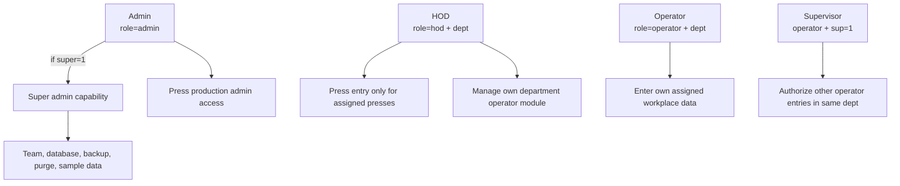

# Roles and Permissions

## Role data model
`users.role` is constrained by the database to `admin`, `hod` or `operator`. Additional flags:
- `users.super`: super-admin privilege (exposed to frontend as `sa`).
- `users.dept`: department association.
- `users.sup`: supervisor flag for an operator.

There is no separate `super_admin` role string in the schema. Super admin is an `admin`-role account with `super=1`.

## Role model

## Frontend navigation
- Admin: Home, Dashboard, Entry, Reports, Operators, Operator details, Targets, Audit log.
- Super admin: all admin tabs plus Team and access, Database, Backup and purge.
- HOD with no department: Home, Dashboard, Entry, Reports.
- HOD with department: adds Operators and Operator details.
- Operator: Data entry.
- Supervisor operator: Data entry and Authorize.

## Backend enforcement
| Action | Effective check |
|---|---|
| Press entry | Admin can enter any configured press; non-admin needs `hod_press` assignment |
| Press lock/unlock | Admin role |
| Press targets | Admin role |
| Account/department/press-access administration | `super` flag |
| Operator workplace/machine/target/assignment changes | `isMgr`: admin role or HOD whose department matches workplace |
| Operator data entry | operator role + assigned workplace |
| Operator authorization | admin/HOD manager for department, or supervisor operator in same department who is not the entry owner |
| Undo operator authorization | manager only (admin or matching HOD) |
| User remark | admin or matching department HOD via `isMgr` |

## Key permission helper
`src/access.js`:
- `isMgr(user, dept)` returns true for any `admin`, or an HOD with a non-empty matching department.
- `wpd(id)` loads a workplace or raises a 404-style error.

## Important distinction
The UI hides tabs users should not access, but backend checks are what protect data. When adding a feature, implement both:
1. navigation visibility in `public/js/core/nav.js`;
2. route/handler authorization in `src/routes/`.

## Verify against business policy
The code shows implementation rules, not necessarily the company's intended organization policy. Confirm whether every admin should be able to manage every department, whether supervisors can authorize all colleagues in their department, and whether the current super-admin account arrangement is still intended.
