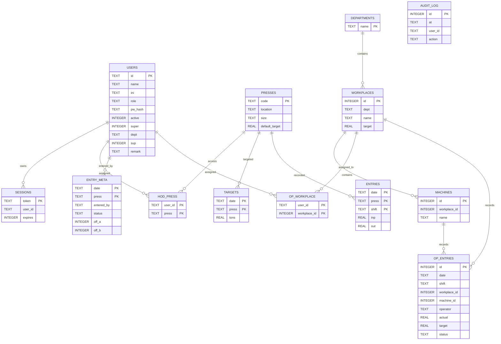

# Database Schema

## Database engine and lifecycle
- SQLite via Node's built-in `node:sqlite`.
- File: `data/datacenter.db` unless `DATA_DIR` overrides it.
- `src/db.js` creates the directory and opens the database when imported.
- `src/migrate.js` enables `journal_mode=WAL` and `foreign_keys=ON`.
- Migrations run at every startup and are intended to be repeat-safe.

## Tables

| Table | Primary key / uniqueness | Purpose |
|---|---|---|
| `users` | `id` | Accounts, role, hashed password, active flag, super flag, department, supervisor flag and remark |
| `presses` | `code` | Configured press metadata and default target |
| `hod_press` | `(user_id, press)` | HOD press access mapping |
| `targets` | `(date, press)` | Date-specific press target |
| `entries` | `(date, press, shift)` | Press shift production and hour categories |
| `entry_meta` | `(date, press)` | Reasons, entered-by, status, off-shift flags and timestamps |
| `audit_log` | autoincrement `id` | Who performed an action and when |
| `sessions` | `token` | Session token, user and expiry |
| `departments` | `name` | Department names |
| `workplaces` | autoincrement `id`; unique `(dept,name)` | Work areas and optional target |
| `machines` | autoincrement `id`; unique `(workplace_id,name)` | Machines belonging to a workplace |
| `op_workplace` | `(user_id,workplace_id)` | Operator/workplace assignment |
| `op_entries` | autoincrement `id`; unique `(date,shift,workplace_id,machine_id,operator)` | Operator shift output and authorization metadata |

## Entity relationship diagram

**Caution:** The diagram is conceptual. The migration SQL does not declare foreign-key constraints for most of these relationships. Several links are enforced by route logic rather than SQLite foreign keys. `entry_meta` is logically keyed to `(date, press)` but is not declared with a SQL foreign key to `entries`.

## Press entry fields
`src/config.js` defines `F`:
`inp`, `out`, `run`, `die`, `pow`, `man`, `log`, `brk`, `noo`, `oth`, `hc`, `dies`, `ord`.

`HF` defines the eight shift-hour categories:
`run`, `die`, `pow`, `man`, `log`, `brk`, `noo`, `oth`.

Database constraints on `entries`:
- shift must be `A` or `B`;
- non-negative checks on input, output and hour categories;
- `out <= inp`;
- the eight hour categories must total 12 hours within 0.005 tolerance;
- unique row per date, press and shift.

The API also validates the 12-hour total and output/input relationship before saving.

## Operator entry fields
- Date, shift (`A` or `B`), workplace, machine (or machine ID `0` when workplace has no machines), operator, actual output, target, status, entered time, authorization user/time.
- Actual output must be non-negative.
- One record per date/shift/workplace/machine/operator.
- An authorized record cannot be edited by the operator through the normal entry endpoint.

## Schema evolution history visible in migration code
The migration includes compatibility checks/additions for:
- `users.super`
- `entry_meta.reason_offa`, `reason_offb`
- operator role support in the `users` CHECK constraint (rebuilds the table if absent)
- departments, workplaces, machines, operator assignments and operator entries
- `entry_meta.off_a`, `off_b`
- `users.remark`

This is the migration logic present in the ZIP, not a full chronological changelog.
