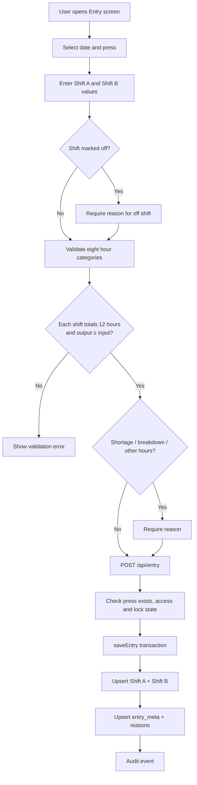
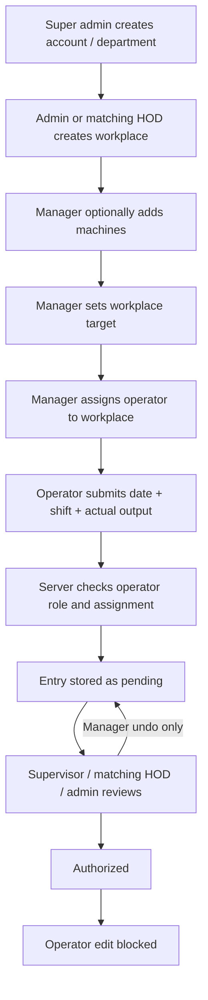

# Business Workflows

## A. Press production entry

Verified rules:
- Both shifts are submitted together.
- A shift marked off is normalized to 12 hours of `oth` in the server-side save path.
- Eight hour categories must sum to 12 hours.
- `out` cannot exceed `inp`.
- Reasons are required when log, breakdown or other hours are present; off-shift reasons are separately required.
- Admin can save a locked entry; a non-admin cannot.
- Non-admin press entry requires an assignment in `hod_press`.

## B. Press targets and reports
- Default press targets live in `presses.default_target`.
- Date-specific targets live in `targets`.
- The frontend target helper uses a date-specific target if present; otherwise it uses the default target, except Saturday defaults to zero.
- Admin can update date-specific targets, change defaults or reset a month's overrides.
- `pressModel()` creates one press's monthly report.
- `cumModel()` creates a cumulative press-wise report.
- Report models are reused for screen, Excel and printable HTML output.

## C. Operator setup and entry

Verified rules:
- An operator must be assigned to the workplace.
- If a workplace has machines, the operator must choose one; if no machines exist, machine ID `0` is used.
- Operator output is rounded to an integer.
- The target value is copied from the workplace at entry time.
- Existing pending entry is upserted; authorized entry is locked from operator editing.
- A supervisor operator can authorize another operator's entry in the same department, but cannot authorize their own.
- Only an admin or matching HOD can undo an authorization.

## D. Account and access management
- Only super-admin can create/reset/toggle accounts, change departments and toggle HOD press assignments.
- New account role is normalized to `admin`, `operator` or `hod`.
- New operators must have a department.
- HOD creation initially assigns all configured presses in `PRESSES`; access can later be toggled.
- Password reset generates a temporary password and removes that user's sessions.
