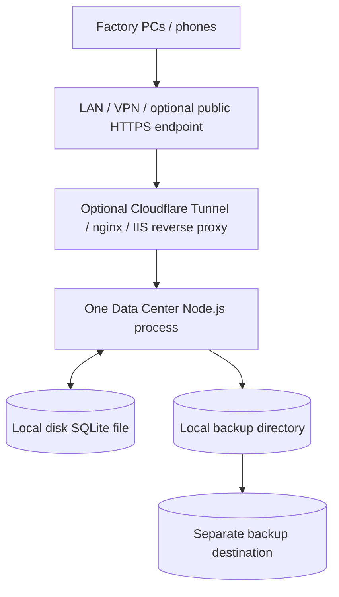

# Backup, Purge and Deployment

## Backup design
`src/backup.js` uses SQLite `VACUUM INTO` to create a consistent, standalone database snapshot.

Filename pattern:
`datacenter-(auto|manual|prepurge)-YYYYMMDD-HHMMSS[-n].db`

Backup location:
`<DATA_DIR>/backups/`

### Backup types
- `auto`: startup/scheduled snapshot; retention pruning applies.
- `manual`: requested from the application.
- `prepurge`: snapshot made immediately before purge.

Automatic schedule:
- Runs once when server starts.
- Rechecks every six hours.
- Creates one automatic backup per date if absent.
- Keeps newest `BACKUP_KEEP` automatic backups (default 14).
- Manual and pre-purge backups are not included in automatic pruning.

## Purge behavior
- Super-admin only.
- Purge selection supports press entries or operator entries, date range, and optional press/workplace target.
- A preview endpoint counts affected rows.
- Confirmation text must be exactly `PURGE`.
- Purge all requires exactly `PURGE ALL`.
- A pre-purge snapshot is created before deletion.
- Deletes are wrapped in a transaction.
- Press purge deletes both `entries` and `entry_meta`.
- Operator purge deletes `op_entries`.
- Purge all deletes all press entries, metadata and operator entries, but preserves accounts, departments, workplaces, targets and presses.
- Purge actions are audited.

## Deployment topology

## Deployment constraints documented in DEPLOY.md
- Install Node.js 22 LTS, version 22.13 or higher.
- Copy project to a local disk; do not run database from network share, OneDrive or Google Drive.
- Run only one server copy against a database file.
- LAN clients use server IP and port; public access should use Cloudflare Tunnel or reverse proxy with HTTPS.
- App marks its sign-in cookie Secure when request has `X-Forwarded-Proto: https`.
- For Windows, `tools/run-forever.bat` is intended for Task Scheduler restart-on-failure/startup.
- For Linux, the deployment guide provides a systemd service example.
- Off-machine backup copy is recommended; local backups alone do not survive disk failure.
- Restore requires stopping server, replacing `data/datacenter.db`, and removing stale `-wal` / `-shm` files if present.
- Updating should copy changed source files only; never overwrite the `data` directory.

## Operational safety checklist
- Verify backup exists and can be opened before a risky update.
- Copy a backup to a separate physical or managed storage destination.
- Test restore on a non-production copy.
- Keep only one live writer process per SQLite database.
- Restrict public exposure behind HTTPS and network access controls.
